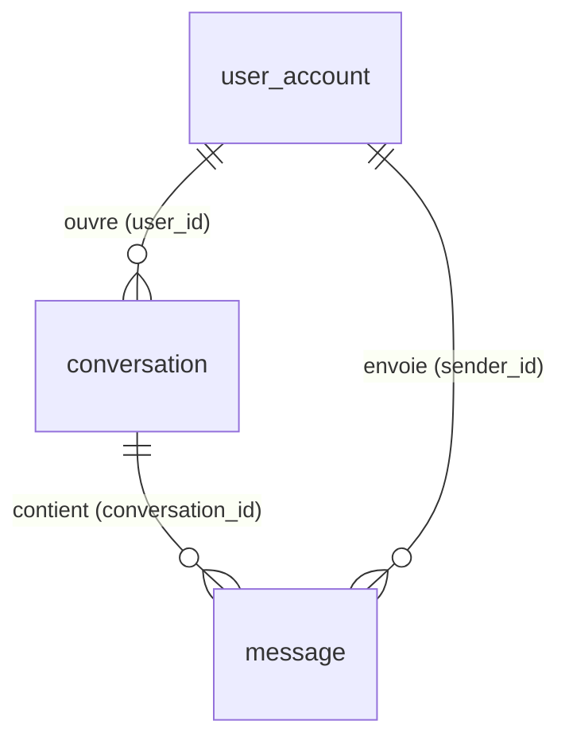

# Your Car Your Way : PoC du tchat

Preuve de concept (OpenClassrooms P10) du tchat en temps réel entre un client
et un agent du service client.

**Stack** : Spring Boot, Angular, PostgreSQL, WebSocket STOMP.

> Cette PoC démontre uniquement la viabilité des choix architecturaux et se focalise sur la fonctionnalité de tchat.

## Sommaire

1. Périmètre
2. Prérequis
3. Installation
4. Lancement
5. Démo
6. Fonctionnement
7. Arborescence
8. Structure des données
9. Dépannage

## 1. Périmètre

Cette PoC (preuve de concept) valide la viabilité des choix architecturaux de la future application Your Car Your Way à travers une seule fonctionnalité : le **tchat en temps réel entre un client et un agent du service client**. Elle ne construit pas l'application complète : tout ce qui n'est pas nécessaire au tchat est exclu, et l'interface est volontairement minimale.

### Inclus

- un client démarre une conversation ;
- un agent l'ouvre depuis un lien propre à la conversation ;
- le client et l'agent échangent en temps réel (WebSocket, protocole STOMP) ;
- les messages sont enregistrés en base et les utilisateurs retrouvent l'historique de leurs échanges.

### Exclus

| Fonctionnalité                  | PoC                                                                                                                                                                     | Cible                                                                                                                               |
| ------------------------------- | ----------------------------------------------------------------------------------------------------------------------------------------------------------------------- | ----------------------------------------------------------------------------------------------------------------------------------- |
| Statut de conversation          | Pas de statut : toutes les conversations restent ouvertes et tout agent peut répondre.                                                                                  | Statut `OPEN` / `CLOSED`, une conversation `CLOSED` n'accepte plus de nouveaux messages.                                            |
| Authentification et rôles       | Deux utilisateurs fictifs (`CUSTOMER` et `AGENT`) déterminés par la vue ouverte, sans mot de passe ni contrôle d'accès (quiconque dispose du lien agent peut répondre). | JWT à courte durée de vie, refresh token révocable dans Redis et vérification des rôles et droits côté serveur via Spring Security. |
| Plusieurs instances et Redis    | Une seule instance du back-end tourne avec le broker STOMP en mémoire de Spring.                                                                                        | Plusieurs instances derrière un load balancer, avec diffusion des messages entre elles via Redis pub/sub.                           |
| Conteneurs et déploiement cloud | Seule la base PostgreSQL tourne dans Docker, tandis que le back et le front restent en local.                                                                           | Conteneurs déployés par la CI/CD sur deux zones de disponibilité.                                                                   |
| Modèle de données complet       | Limité aux tables `user_account`, `conversation` et `message`, réduites aux colonnes nécessaires au tchat.                                                              | Schéma PostgreSQL unique couvrant utilisateurs, agences, véhicules, réservations, paiements et conversations.                       |

## 2. Prérequis

- JDK 25 (LTS), vérifier avec `java -version`
- Node.js 24 LTS (minimum) et npm
- Docker Desktop lancé

## 3. Installation

### Front-end

```bash
cd front
npm install
```

### Base de données

```bash
cd back
cp .env.example .env # puis choisir un mot de passe dans .env
docker compose up -d # démarre PostgreSQL (facultatif : Spring Boot lance la base automatiquement)
docker compose ps # l'état doit passer à "healthy"
docker compose down # arrêt (les données sont conservées)
```

Le fichier `.env` n'est jamais versionné (seul `.env.example` l'est).

## 4. Lancement

### Back-end

```bash
cd back
./mvnw spring-boot:run   # démarre PostgreSQL (compose.yaml) puis l'API sur http://localhost:8080
```

### Front-end

```bash
cd front
npm start   # http://localhost:4200
```

Le serveur de développement (`ng serve`) active un proxy (`front/proxy.conf.json`, déclaré dans
`front/angular.json`) : `/api` et `/ws` sont redirigés vers le back (`localhost:8080`), ce qui
évite toute configuration CORS. Le back doit donc être lancé avant d'utiliser l'application.

### Tests du back-end

```bash
cd back
./mvnw test   # Docker Desktop doit être lancé : une base PostgreSQL jetable est créée (Testcontainers)
```

## 6. Fonctionnement

### API REST

| Méthode | URL                                | Réponse                                                         |
| ------- | ---------------------------------- | --------------------------------------------------------------- |
| GET     | `/api/users`                       | Utilisateurs de démonstration                                   |
| POST    | `/api/conversations`               | `201`, conversation créée (sans corps de requête)               |
| GET     | `/api/conversations`               | Conversations, plus récentes d'abord                            |
| GET     | `/api/conversations/{id}/messages` | Historique chronologique, `404` si la conversation est inconnue |

Documentation interactive (back lancé) :

- Swagger UI : <http://localhost:8080/swagger-ui.html>
- Spécification OpenAPI (JSON) : <http://localhost:8080/v3/api-docs>

> Swagger UI et `/v3/api-docs` sont activés pour la démo. En production, ils seraient désactivés
> (`springdoc.swagger-ui.enabled=false` et `springdoc.api-docs.enabled=false`).

### Temps réel (WebSocket STOMP)

| Usage              | Destination                                                                       |
| ------------------ | --------------------------------------------------------------------------------- |
| Connexion          | `ws://localhost:8080/ws` (via le proxy Angular : `/ws`)                           |
| Envoi d'un message | `/app/conversations/{id}/messages`, corps `{"senderId": "...", "content": "..."}` |
| Réception          | abonnement à `/topic/conversations/{id}`                                          |

Le serveur valide le message (non vide, 2000 caractères maximum, expéditeur existant), l'enregistre,
puis le diffuse. Un message invalide est journalisé et ignoré.

## 7. Arborescence

```text
.
├── back/    # API Spring Boot + WebSocket STOMP
├── front/   # Application Angular
└── README.md
```

## 8. Structure des données

Le schéma est créé par Flyway (`back/src/main/resources/db/migration`) : `V1` pour les
tables, `V2` pour deux utilisateurs de démonstration (avec des id sous forme de UUID fixes).



| Table          | Colonnes                                                                         | Remarque                                                                                                |
| -------------- | -------------------------------------------------------------------------------- | ------------------------------------------------------------------------------------------------------- |
| `user_account` | `id`, `first_name`, `last_name`, `role` (`CUSTOMER`/`AGENT`), `created_at`       | Sous-ensemble de la table `user_account` de la proposition d'architecture (sans email ni mot de passe). |
| `conversation` | `id`, `user_id`, `created_at`                                                    | `user_id` : le client de démonstration.                                                                 |
| `message`      | `id`, `conversation_id`, `sender_id`, `content` (1 à 2000 caractères), `sent_at` | `sent_at` est fixé par le serveur ; l'historique est trié dessus.                                       |

## 9. Dépannage

### Flyway

#### Migration checksum mismatch

Une migration déjà appliquée a été modifiée. En développement, réinitialiser la base
(les données de démonstration sont perdues) :

```bash
cd back
docker compose down -v
./mvnw spring-boot:run
```
